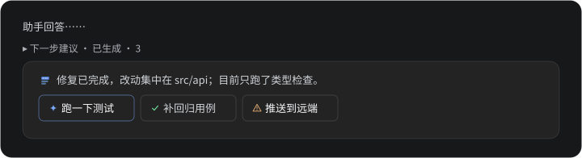

# 设计：下一步建议

## 要解决的问题

一轮工作结束后，用户常常要自己想清楚下一句该说什么，再把它打出来。模型此时最了解刚发生了什么，
所以由它在收尾时顺手给出几步，用户点一下就能把完整指令放进输入框，改完自己发送。

整个产品服务一条路径：**看一眼 → 点一下 → 在输入框里改**。新增任何机制前，先确认它服务这条路径。

## 理念

1. **回答的下一句，而不是新模块。** 卡片位于该轮内容最下方、消息动作行之前，先用一两句话承接刚才的结果，再给出动作；
   建议不会凭空出现，也不进入回答正文。
2. **交给人，不替人做。** 点击只填入，永不发送；输入框里已有的内容永不覆盖；危险操作同样只填入。
   用户永远在发送前有最后一次修改的机会。
3. **会话日志是唯一事实。** 卡片来自工具调用的记录，"已使用"来自用户真正发出的下一条消息；
   插件不另存状态，刷新、回放、换设备看到的都一样。"使用"指做了这一步，而不是按了这个按钮。
4. **安静，可以忽略。** 最多三条；状态不占文字，每个按钮至多一个前置图标，辅以描边和字色的轻微变化，
   不加徽标、文字标签或弹层。不需要时继续对话即可，不弹窗、不设置、不打扰。
   没有真实后续工作的回合不出卡片。
5. **长在 DSH 上。** 外观沿用官方动作卡与过程行，只用主题 token；用户不应看出这是另一套界面。
6. **少即是多。** 能由已有事实推出来的就不存，能由用户自己完成的就不做；
   每一处代码都要能回答它服务哪条理念。

## 体验

下图是连续两轮里卡片的两种状态：上一轮的卡片已得到回应，折叠成一行并标出用过的建议；
本轮回答末尾是当前卡片，完整展开，等待下一条消息。

**浅色主题**

**深色主题**

示意图按 DSH 0.2.2 的界面绘制，颜色取各主题的 token 值；实际外观随 DSH 明暗主题变化。

- **上下文**：卡片第一行是 1–2 句话，说明刚才做了什么、为什么是这几步。
- **建议**：最多 3 条，按模型给出的顺序排列；按钮文字完整显示，过长时换行，不在显示时截断。
  标签宽度上限 80 列（约 80 个拉丁字符或 40 个中文字符）：中日韩文字、全角符号和 emoji 按 2 列计，其他字符按 1 列计，
  因此中文和英文按视觉宽度而不是字符数判断。超过时这次调用不发布卡片，而是返回错误，
  请模型把标签缩成几个词、细节留在指令里后重新调用。
  悬停显示完整指令（原生提示），不改变布局。
- **推荐**：模型至多标 1 条，固定排第一；按钮描边带品牌蓝，前置 ✦。
- **危险**：模型标记或命令形状的风险模式命中时前置 ⚠，可访问名带「需确认」。
- **已使用**：这是从用户发出的文本推断出来的，不是点击记录；手动输入相近的内容也会被标记。
  判定依据是这张卡片之后、第一个由用户消息开启的回合里的第一条消息：中间没有用户消息的回合（注入上下文、唤醒）跳过，
  但如果那一轮自己出了卡片，这条消息就归新卡片；第一条消息没有文字（例如只回复图片）时不做判定，也不向后借。
  对每个选项各自判定：
  - 消息中有连续的整行与该指令一致（忽略空白）→ ✓。点击填入通常让指令单独成行；
    用空格接在同一段话里时它不单独成行，因此不算原样发送；用换行接在下一段时仍单独成行。
    藏在一句话里的短词或「不要 + 指令」同理。
  - 某一行或某一段按原顺序保留了指令的大部分字符，并且没有被大量新内容稀释（基于最长公共子序列的 Dice 相似度 ≥ 0.6）→ 铅笔，表示「改后发送」。
    否定句同样算改后发送；去掉空白后不足 4 个字的指令只认原样发送。
  - 其他情况不标。

  已使用的按钮文字转为二级色。每个按钮只放一个前置图标：✓ 或铅笔 > ⚠ > ✦；所有状态都写进可访问名。
- **点击 = 填入**：草稿为空、仅含空白，或仍是卡片刚填入且未改动的文字 → 整段替换。
  卡片填入后，用户只在末尾追加空白时，这段空白是给下一条建议的意图，点击时被消费：
  换行表示空一行再写，补到至少一个空行；用户已经打出多个换行则保留，不再增加。
  空格或制表符表示接在同一段话里：前一条最后一个字符与后一条第一个字符都是中文、日文文字或标点时
  不插空格，其余情况（含中英相接）保守插一个空格；用户多打的空白收成一个或删掉。
  这个信号只在卡片自己刚填入的文字后出现纯尾随空白、且光标位于末尾时生效；它重写卡片自己那段文字，
  不碰用户内容与 `@` 引用；用户自己草稿里的尾随空白不删，按普通插入处理。
  信号用掉后，草稿就是用户正在编辑的内容；此后不加空白直接点另一条，按普通插入处理，在末尾接一个空行。
  没有信号时：草稿里有用户自己的内容 → 在光标处插入指令，作为一次编辑器编辑，保留 `@` 引用，⌘Z 可撤销；
  光标在末尾且已有换行时只补到出现一个空行，不再叠加；光标在中间时仍插入「空行 + 指令」；指令后不留换行。
- **折叠**：卡片得到回应后折叠成一行，长会话里只有当前卡片完整展开。回应沿用「已使用」的判定边界：
  卡片之后第一个由用户消息开启的回合，或更晚一轮自己出的卡片。折叠行是「▸ 标志 下一步建议 · 摘要」：
  摘要列出用过的建议及其 ✓ 或铅笔，一条都没用时只显示未使用的条数；计数文案用不含数词一致性的短语
  （如「2 unused」「2 条未使用」「2 sans suite」「2 не использовано」），1–3 条建议在各语言下都成立，不引入复数规则引擎；悬停显示上下文。
  点击折叠行展开，展开后的历史卡片在上下文行末尾有收起按钮。当前卡片不设收起按钮，不需要时继续对话，它自然折叠。
  手动展开或收起只在当前页面有效，刷新后回到由会话日志推出的默认状态。
- **随会话保存**：每一轮的卡片都在，历史卡片展开后仍可点击填入。回合刚结束时出现的卡片做入场动画；折叠行与卡片常驻同一个容器，手动展开、手动收起和得到回应后的自动折叠共用一段行高过渡，`prefers-reduced-motion` 下不做动画。
- **过程行**：工具过程组里一行「下一步建议 · 正在生成 / 已生成 · N / 未显示」。
- **语言**：卡片文案与状态标记跟随 DSH 界面语言，维护 DSH 支持的八种语言（zh、en、ja、es、fr、de、ru、pt）；没有对应字典的语言回退英文。

不做：自动发送、确认弹层、设置页、单轮忽略按钮、额外的模型请求。全局关闭用 Host 配置
`enabled: false`，此时不注册工具与提示词，零 token。

## 机制

| 部分 | 文件 | 职责 |
| --- | --- | --- |
| Host | `index.js` | 为根 agent 注册 `suggest_next_actions` 与一段常驻提示；子代理不注册（按会话 header 的 `origin` 区分）；安装与判定失败写日志；`enabled:false` 时什么都不注册 |
| 规范化 | `lib/normalize.js` | 参数 → `{ shown, context, suggestions[≤3] }`：折叠空白、截断上下文与指令、按指令去重、推荐至多一条且置顶；显式标签保持完整，超宽时在执行前交回模型缩短；危险标记来自模型字段或命令形状模式。结果作为 `tool/result.meta` 写入会话日志 |
| Client | `client.js`（手写单文件，含 CSS） | 两个 Conversation Definition：`next-actions` 把本工具结果上的 meta（native 与 PTC `run_code` 两条通路）发布为该轮卡片；`next-actions-sent` 把用户在该轮发出的第一条 `user/message` 发布为 `sent` 文本。`conversation.chat.turnTail` 渲染卡片；`tool.call.toolview` 渲染过程行 |

会话日志只追加，压缩不删除原 `tool/result`，所以客户端直接读 meta，不重算参数，也不需要构建步骤；
压缩产生的替换副本一律忽略，避免同一张卡片发布两次。第 N 轮的卡片通过 `useChat` 的 `timeline.turnOrder` / `timeline.turns` 读第 N+1 轮的 `sent` 文本来判定
"已使用"；同一次查找也决定折叠：找到回应的卡片默认折叠，手动切换只存在组件状态里。

事件归到哪一轮由引擎决定。同一个 Definition 服务页面里所有会话的 assembler，翻页加载旧历史（`prepend`）时还会对更早的事件重跑 `match`，
所以 `match` 只看当前事件、不持有状态：卡片按调用 id（PTC 按根调用 id）、消息按消息 id 建 Context，
轮次在 `start` 里从引擎解析好的 `match.location` 读取。引擎规定每轮的同一个 Location key 只能有一个 owner，
因此同一轮里第一个产出卡片的调用拥有卡片，第一条用户消息拥有 `sent`；后来者通过 `reader.previous` 看到前驱已占用就不再发布。外部插件不能 require Harness Client 包，所以卡片样式按官方动作卡重写，类名用 `dshna-` 前缀；
刚结束的回合用 CSS `grid-template-rows` 展开卡片，避免回答被一帧顶起；折叠行与卡片各占一行常驻在同一个网格里，收起与展开过渡行高，离开的一行在过渡结束后才退出可见性与焦点顺序，`prefers-reduced-motion` 下不做动画。
