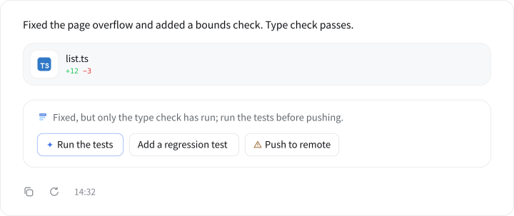
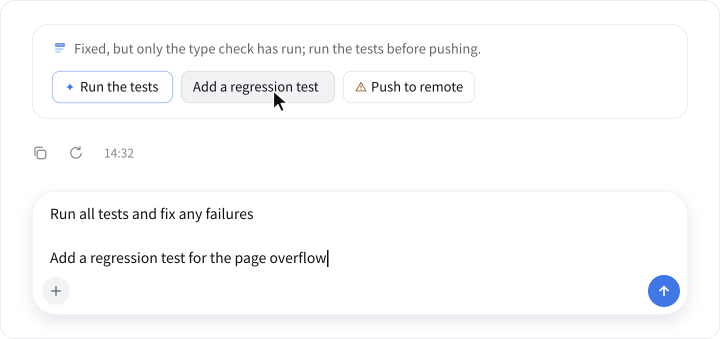
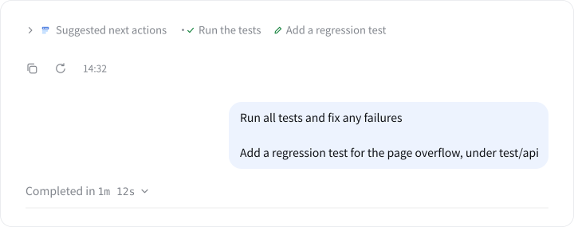

# dsh-next-actions

English | [中文](README.zh.md)

> Skip the typing, not the thinking.

When a turn wraps up, you usually have to work out what to say next and then type it all out.
The model knows best what just happened, so this DSH plugin has it offer one to three next steps at the end of its reply.
Click one and the full instruction lands in your input box; use it as is, change a few words, or ignore it. The plugin never sends anything for you.

**Status: v0.1.8 (npm package: [dsh-next-actions](https://www.npmjs.com/package/dsh-next-actions)).**
See [`DESIGN.md`](DESIGN.md) for the design and rationale, and [`CHANGELOG.md`](CHANGELOG.md) for release notes.

## Install

Requires DSH 0.2.2-rc.1 or later, with a Host that supports the Web Client (Desktop and Web both work).

```sh
dsh plugin --profile desktop add dsh-next-actions
```

You can also install the same bundle with `plugin_manager`'s `install_bundle`, or by selecting it on the Plugins page in the Web sidebar.
Restart DSH after installing.

For local development, install this directory with `link:`:

```sh
dsh plugin --profile desktop add link:/path/to/dsh-next-actions
```

## Features

- Each card is one or two sentences of context plus up to three buttons. It is stored with the session, so it survives refresh and replay.
- Button labels always show in full and wrap when long; they are never cut off. Labels are capped at 80 display columns (CJK and fullwidth characters count as 2, so about 80 Latin or 40 Chinese characters); a longer label goes back to the model to be shortened.
- The model's recommended action comes first, marked ✦ with a brand-colored outline. A risky action carries ⚠, and clicking it still only fills the input.



- Clicking fills the input and never sends. An empty input simply receives the instruction; if you have already typed something, it is inserted at the caret, `@` references stay intact, and ⌘Z undoes it.
- To chain actions, type a newline at the end after one fill and click the next: it starts a new paragraph. Type a space instead and it joins the same paragraph (no space between two CJK sentences, one space otherwise).



- Once you send, the card shows what you used: a check for an action sent as is, a pencil for one you edited. This is inferred from the text you sent, not from clicks, so typing something similar by hand is marked too.
- Answered cards fold into a single row listing the actions you used, while the current card stays open. Click a folded row to expand it; folding and unfolding are animated.



- The plugin takes one row in the tool process, and subagents never get the tool. Set `enabled: false` in the Host config to turn it off entirely, with zero standing tokens.
- The card's own labels follow DSH's interface language: Chinese, English, Japanese, Spanish, French, German, Russian and Portuguese.
- Works in PTC (`run_code`) sessions.

## Layout

```text
index.js            Host: tool, root-agent standing prompt, enabled gate
lib/normalize.js    Argument normalization; writes the card model to tool/result.meta
client.js           Client (hand-written single file): definitions, card, process row and CSS
cordis.patch.yml    Plugin row patch
locale/             Plugin metadata (title and description) per DSH language
test/               node --test
assets/promo/       Promo video: sources, poster and render scripts (output is not committed or published to npm)
```

## Development

```sh
node --test         # tests
npm pack --dry-run  # packaging check
```

Use `plugin_manager`'s `install_bundle` / `remove_bundle` to install or uninstall; verify with a fake `DSH_HOME`.
Restart DSH for Host changes; refresh the page for Client changes.

## Release

After updating the version in `package.json` and `CHANGELOG.md`:

```sh
node --test
npm pack --dry-run
git tag -a v<version> -m "v<version>"
git push origin main --tags
npm publish --access public
npm view dsh-next-actions version   # confirm latest points at the new version
```

After publishing, install once from the registry with a fake `DSH_HOME`; local `link:` installs do not need switching.

To turn the feature off, add this to the profile's `cordis.patch.yml`:

```yaml
- id: dsh-next-actions
  name: 'dsh-next-actions'
  config: { enabled: false }
```

## License

MIT (see [LICENSE](LICENSE)).
The card appearance follows the MIT-licensed official DSH action cards; see [NOTICE](NOTICE) for attribution.
This is not an official DeepSeek plugin.
