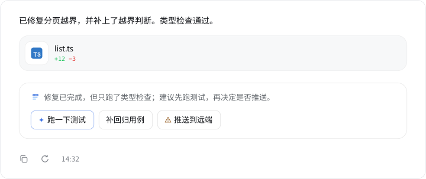
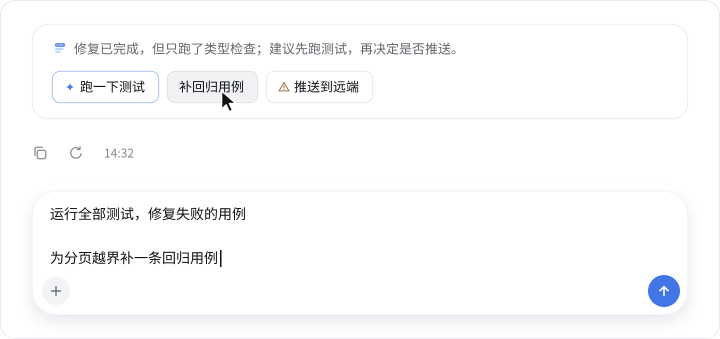
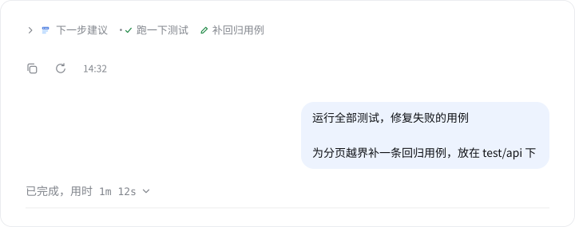

# dsh-next-actions

[English](README.md) | 中文

> 省下的是打字，不是思考。

一轮工作结束，下一句要说什么，往往得自己想好，再一字一字打出来。
模型这时最清楚刚发生了什么，这个 DSH 插件就让它在回答末尾顺手给出一到三条下一步：
点一下，完整的指令就放进输入框；原样用、改几个字，还是干脆不用，都由你决定。插件从不替你发送。

**状态：v0.1.7（npm 包：[dsh-next-actions](https://www.npmjs.com/package/dsh-next-actions)）。** 设计与理念见 [`DESIGN.md`](DESIGN.md)，版本记录见 [`CHANGELOG.md`](CHANGELOG.md)。

## 安装

要求 DSH 0.2.2-rc.1 或更高版本；Host 需要支持 Web Client（Desktop 与 Web 均可）。

```sh
dsh plugin --profile desktop add dsh-next-actions
```

也可以让 agent 用 `plugin_manager` 的 `install_bundle` 安装同名 bundle，或在 Web 侧栏的 Plugins 页面里选中它。装好后重启 DSH。

本地开发时用 `link:` 安装本目录：

```sh
dsh plugin --profile desktop add link:/path/to/dsh-next-actions
```

## 功能

- 每张卡片是一两句上下文加至多三个按钮，随会话保存，刷新或回放后仍在。
- 按钮文字完整显示，太长就换行，从不截断。标签上限 80 列（中日韩文字和全角符号算 2 列，约合 80 个拉丁字符或 40 个汉字），超出时插件请模型缩短后重新给出。
- 模型推荐的一条排在最前，带 ✦ 和品牌色描边；有风险的一条带 ⚠，点了同样只是填入。



- 点击只填入，永不发送。输入框是空的就直接填入；已经写了内容，就插在光标处，`@` 引用不受影响，⌘Z 可以撤销。
- 想连着用几条：点完一条，在末尾敲个换行再点下一条，它会另起一段接上；敲空格则接在同一段（两边都是中文或日文时不加空格，否则留一个）。



- 消息发出后，卡片会标出你用了哪条：原样发出的打勾，改过再发的画铅笔。标记从你发出的文字推断，不记录点击，所以手打出相近的内容也会被标上。
- 回应过的卡片折叠成一行，只列出用过的建议，当前那张始终展开；点一下折叠行就能展开历史卡片，折叠和展开都有过渡动画。



- 在工具过程里只占一行，子代理不会拿到这个工具。在 Host 配置里写 `enabled: false` 即可整个关闭，不占任何常驻 token。
- 卡片上的文案跟随 DSH 界面语言，支持中文、英文、日文、西班牙文、法文、德文、俄文和葡萄牙文。
- 兼容 PTC（`run_code`）会话。

## 结构

```text
index.js            Host：工具 + 根 agent 常驻提示 + enabled 门控
lib/normalize.js    参数规范化，结果写入 tool/result.meta
client.js           Client（手写单文件）：Definition、卡片、过程行与 CSS
cordis.patch.yml    插件行 patch
locale/             插件元数据：各 DSH 语言的标题与描述
test/               node --test
assets/promo/       宣传片：源文件、封面与渲染脚本（成片不入库，不随 npm 发布）
```

## 开发

```sh
node --test         # 测试
npm pack --dry-run  # 打包检查
```

安装/卸载用 `plugin_manager` 的 `install_bundle` / `remove_bundle`；验证使用假 `DSH_HOME`。
Host 改动需重启 DSH，Client 改动需刷新页面。

## 发布

改 `package.json` 版本与 `CHANGELOG.md` 后：

```sh
node --test
npm pack --dry-run
git tag -a v<version> -m "v<version>"
git push origin main --tags
npm publish --access public
npm view dsh-next-actions version   # 确认 latest 指向新版本
```

发布后用假 `DSH_HOME` 从 registry 装一次；本机 `link:` 安装不需要切换。

关闭功能：在 profile 的 `cordis.patch.yml` 写

```yaml
- id: dsh-next-actions
  name: 'dsh-next-actions'
  config: { enabled: false }
```

## 许可

MIT（见 [LICENSE](LICENSE)）。卡片外观参照 MIT 许可的 DSH 官方动作卡，归属说明见 [NOTICE](NOTICE)。非 DeepSeek 官方插件。
